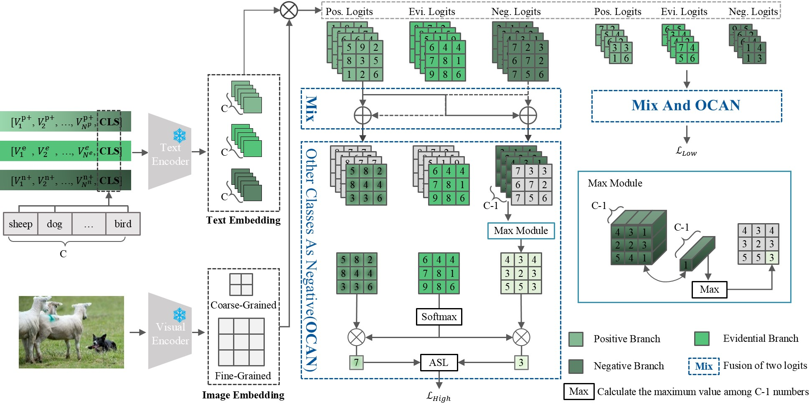

# DPCoOp: Dual Positive Context Optimization for Multi-Label  Recognition with Limited Annotations

## Introduction



## Set-up Experiment Environment
Our implementation is in Pytorch with python 3.9. 

Use `conda env create -f environment.yml` to create the conda environment.
In the conda environment, install `pycocotools` and `randaugment` with pip:
```
pip install pycocotools
pip install randaugment
```
And follow [the link](https://github.com/KaiyangZhou/Dassl.pytorch) to install `dassl`.

## Acknowledgments
We adapted and refactored substantial parts of the [CoOp](https://github.com/KaiyangZhou/CoOp) and [DualCoOp](https://github.com/sunxm2357/DualCoOp) codebases. We thank Kaiyang Zhou and Ximeng Sun for releasing their code.
